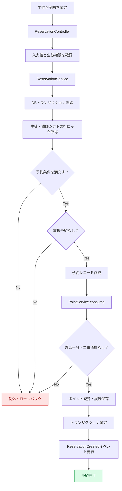
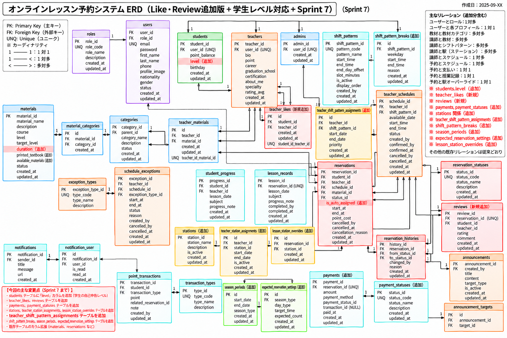

# KKEnglish — English Lesson Management System

**英会話スクール向けレッスン予約・講師スケジュール・ポイント管理システム**

`PHP 8.2+` · `Laravel 12` · `MySQL` · `Blade` · `JavaScript` · `Bootstrap` · `Laravel Reverb`

> 本リポジトリは、3名で共同開発した[元のKKEnglishリポジトリ](https://github.com/kredo-school/25th_Batch_KKEnglish_Offline)のForkです。就職活動用に、システム全体の機能と自分が担当したバックエンド領域を区別して紹介しています。

## 1. プロジェクト概要

KKEnglishは、生徒・講師・管理者の3ロールを持つ英会話スクールの運営支援Webアプリケーションです。予約、勤務シフト、キャンセル、ポイント消費・返還、学習履歴などの関連業務を一元管理することを目指しました。

| 項目 | 内容 |
| --- | --- |
| 開発期間 | 2026年7月〜10月（約3か月） |
| 開発体制 | 3名のチーム開発 |
| 個人担当 | 生徒・講師向けバックエンド |
| バックエンド | PHP 8.2以上 / Laravel 12 |
| データベース | MySQL |
| フロントエンド | Blade / HTML / CSS / JavaScript / Bootstrap |
| その他 | Git / GitHub / Vite / Laravel Reverb / Laravel Echo |
| テスト | PHPUnit（テストファイルあり、網羅性は検証中） |

## 2. 画面プレビュー

実際にローカル環境で起動した画面です。掲載画像にはデモ用データが含まれます。

### 講師検索・予約


### 講師詳細・予約可能枠


### ポイント消費・返還履歴


[その他の画面を見る](#9-その他の画面)

## 3. 主な機能

| ロール | 主な機能 |
| --- | --- |
| 生徒 | 講師検索、予約・キャンセル、空き枠確認、ポイント履歴、お気に入り、レビュー、学習履歴・進捗 |
| 講師 | 担当予約の確認、勤務スケジュール、スケジュール例外、レッスン結果登録・履歴 |
| 管理者 | 生徒・講師・教材管理、シフトパターン・割当、予約・稼働状況の確認、運用ダッシュボード、お知らせ管理 |

これらはリポジトリのController、Service、View等で確認できる機能の概要です。公開デモでの動作検証済みという意味ではありません。

## 4. 自分の担当範囲

3名のチーム制作のうち、私は主に生徒・講師向けのバックエンドを担当しました。

- Controller / Service / Model / Migrationの作成・修正
- レッスン予約・キャンセル関連の業務処理
- 講師の空き時間計算と予約重複チェック
- 予約に伴うポイント消費・返還処理
- 講師のスケジュールと授業結果に関わる処理
- 他メンバーとのデータ構造・画面との連携確認

管理者機能やフロントエンドの多くは他メンバーが担当しています。

## 5. 技術的な工夫

### 予約の競合制御とデータ整合性

同一講師・時間帯への同時予約を考慮し、`ReservationService` で次の実装を行いました。

- `DB::transaction()` で予約登録とポイント消費を一連のトランザクションとして処理
- `lockForUpdate()` で生徒・講師スケジュールのレコードをロック
- 有効な既存予約との時間帯重複を検査
- 講師と教材の適合、勤務シフト、休止時間、レッスン時間を検証

```php
$reservation = DB::transaction(function () use ($student, $data) {
    $student = Student::query()
        ->whereKey($student->getKey())
        ->lockForUpdate()
        ->firstOrFail();

    $schedule = TeacherSchedule::query()
        ->whereKey($data['schedule_id'])
        ->lockForUpdate()
        ->firstOrFail();

    // 予約条件の検証、予約作成、ポイント消費（抜粋）
});
```

**目的:** 予約とポイント残高の不整合を防ぎ、同時操作による競合を抑えることです。あらゆる並行アクセスで重複を防げる保証については、DB制約や並行実行テストによる追加検証が必要です。

### 空き枠生成

`AvailabilityService` では勤務シフトから30分単位の予約枠を生成します。講師の既存予約、生徒自身の他予約、スケジュール例外、過去時刻、予約締切などを考慮します。

### ポイント管理

`PointService` では残高不足・二重消費・二重返還を検出し、`PointTransaction` にポイント取引履歴を保存します。

### ビジネスルールの分離と改善課題

予約とキャンセルのポリシーを別Serviceへ分離しています。一方、予約締切の条件はService間で差があるため、ルールの一元化とテスト拡充が今後の課題です。

## 6. 予約処理フローチャート

生徒が予約確定を行った際の主な処理です。



**設計上のポイント:** 予約登録とポイント消費の一体的な処理、行ロックによる競合抑制、講師・生徒双方の重複チェック、取引履歴の保存、予約確定後のイベント発行。

## 7. データベース設計（ERD）

チーム開発時に作成したSprint 7時点の設計資料です。最終的な実装と一部異なる可能性があります。



- `users` を基点に `students` / `teachers` / `admins` を管理
- `reservations` と生徒・講師・教材・予約ステータスを関連付け
- `teacher_schedules` と `schedule_exceptions` により勤務時間・例外時間を管理
- `point_transactions` によりポイントの消費・返還履歴を管理
- `reservation_histories` により予約状態の変化を追跡

## 8. アーキテクチャ・データモデル

LaravelのMVCをベースに業務処理をServiceに分離しています。

```text
Browser → Route → Controller → Service → Eloquent Model → Database
```

| Service | 主な役割 |
| --- | --- |
| `ReservationService` | 予約条件の検証、重複チェック、予約作成、授業結果処理 |
| `AvailabilityService` | 予約枠の生成と既存予約・例外時間との照合 |
| `PointService` | ポイント消費・返還、残高・取引履歴管理 |
| `BookingPolicyService` | レッスン形式・予約締切などのルール判定 |
| `CancellationPolicyService` | キャンセルのペナルティ率・ポイント計算 |
| `TeacherSearchService` | 講師検索処理 |

主なデータモデルは、`User`、`Student`、`Teacher`、`TeacherSchedule`、`Reservation`、`ReservationHistory`、`PointTransaction`、`Material`、`LessonRecord`、`Review`、`ScheduleException` です。

## 9. その他の画面

### トップページ


### 生徒ダッシュボード


### 講師スケジュール


### 管理者ダッシュボード


### ログイン


## 10. テストと今後の改善

リポジトリにはPHPUnitのFeature / Unitテストがありますが、主要ロジックの網羅性や実行成功率を検証済みとはしていません。

今後の改善予定：

1. 同時予約、予約重複、処理失敗時のロールバックのテスト
2. ポイント不足・二重消費・二重返還のテスト
3. 予約締切・キャンセル条件の統一と境界値テスト
4. ロール別アクセス制御のテスト
5. Laravel Pint・静的解析・CIの導入
6. 短い操作デモの追加と安全なデモ環境のWeb公開

## 11. ローカルセットアップ（参考）

**必要環境:** PHP 8.2以上、Composer、Node.js / npm、MySQL

```bash
git clone https://github.com/otakiosamu/25th_Batch_KKEnglish_Offline.git
cd 25th_Batch_KKEnglish_Offline
composer install
npm install
```

このリポジトリには `.env.example` が含まれていません。既存の安全なローカル用 `.env` を利用するか、Laravel 12の設定例を参考に新しく作成し、MySQL接続情報を設定してください。**秘密情報をGitHubにコミットしないでください。**

```bash
php artisan key:generate
php artisan migrate
# 初期データが必要な場合はSeederの内容を確認
php artisan db:seed
php artisan serve
```

別のターミナルで `npm run dev` を実行します。通常は http://127.0.0.1:8000 でアクセスできます。Laravel Reverb等は別途設定が必要です。

**注意:** クリーン環境での再現性は未検証です。Seederのダミーアカウントを本番公開環境でそのまま利用しないでください。

## 12. 開発を通じて学んだこと

単純なCRUDだけでなく、予約枠、ポイント、講師の勤務状況といった複数のビジネスルールをデータとコードで表現する重要性を学びました。Serviceによる責務分離、データ整合性と競合制御、チームメンバーとの仕様調整が特に重要な経験となりました。

## 13. リポジトリ・クレジット

- **Original（チーム制作）:** https://github.com/kredo-school/25th_Batch_KKEnglish_Offline
- **Portfolio Fork（個人用）:** https://github.com/otakiosamu/25th_Batch_KKEnglish_Offline
- **GitHub Profile:** https://github.com/otakiosamu

本アプリケーションは3名による共同制作です。元のチームメンバーの貢献は、Fork元のコミット履歴から確認できます。
